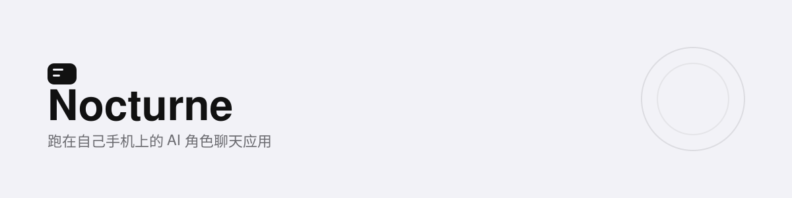

<div align="center">



# Nocturne

**在手机上本地运行的 AI 角色聊天应用**

角色聊天 · 小剧场 · 朋友圈 · 世界书 · 生图

[](LICENSE)
[](https://nodejs.org)
[](https://github.com/Yuiichi093/Nocturne/actions/workflows/ci.yml)

</div>

---

## 简介

Nocturne 是一个本地运行的角色扮演聊天应用。数据存在设备上的 SQLite 里，不经过任何服务器。

界面为 iOS 风格：分组灰底、白卡片、底部升起的面板。

应用本身不含模型，需要填入一个 OpenAI 兼容接口（Base URL、模型名、API Key），也可以接本地模型。

## 功能

**聊天**
- 角色人设、用户人设、开场白，支持多套人设
- 回复分为旁白与对白
- 支持发送图片，角色可以读图，也可以按角色参考图生成图片
- 每个角色一套表情包，含义可自定义
- 一次生成三份候选回复，可重新生成

**小剧场**
- 剧本生成会话，可扮演角色或以上帝视角推进
- 剧情提示、重选、分支、章节管理
- 为当前场景生成插画，图片进入剧情流

**朋友圈**
- 角色可以评论、点赞、自主发动态
- 同一世界观的角色互相可见
- 角色可以读取图片内容

**账号**
- 单机多账号，账号之间的数据互不可见
- 登录、注册、改密码、退出
- 升级前的数据由第一个注册的账号继承

**其他**
- 世界书：关键词检索，包含角色名匹配
- 多世界观、日历与节日、消息编辑与历史版本
- 备份导出与恢复，备份默认不含 API Key
- 文字、看图、生图可分别指定模型

## 截图

<!-- 截图放到 docs/screenshots/ 后，换成：
| 聊天 | 小剧场 | 朋友圈 |
| --- | --- | --- |
|  |  |  |
-->

## 安装

### Android APK

从 [Releases](https://github.com/Yuiichi093/Nocturne/releases) 下载 `app-release.apk`。
适用于 arm64 设备，Android 8.0 及以上。版本更新直接覆盖安装，数据保留。

应用内已包含运行所需的一切，不需要安装 Termux 或 Node.js。

### 手机（Termux）

```bash
pkg install nodejs
git clone https://github.com/Yuiichi093/Nocturne.git
cd rolephone
npm install
node server.js
```

打开 `http://127.0.0.1:8787`。想开机自启可以用 Termux:Boot；想有桌面图标，浏览器菜单里选「添加到主屏幕」。

### 电脑

命令相同。启动后打开 `http://127.0.0.1:8787`，数据在 `data/` 下自动生成。

### 版本要求

推荐 Node 24 及以上。Node 18～22 也可以运行：没有内置 `node:sqlite` 时自动改用 `sql.js`
（WASM 版 SQLite），功能一致，写入落盘稍慢。

## 配置模型

打开「模型设置」，填入 Base URL、模型名、API Key，点「测试」会做一次自检，显示该模型
能否看图、能否生图。

- 文字与思考：日常对话、剧情、朋友圈
- 看图：读取发送给角色的图片
- 生图：生成图片

## 数据与账号

数据目录为 `data/`：数据库、上传的图片、备份都在这里，不参与版本控制。

新增账号不需要注册任何在线服务，账号仅存在本机 `data/auth.db`。
备份按账号导出，账号 A 的备份不包含账号 B 的内容。详见 [docs/ACCOUNTS.md](docs/ACCOUNTS.md)。

## 开发

```bash
npm start             # 启动服务，默认 http://127.0.0.1:8787
npm run check         # 语法检查
```

架构说明见 [docs/ANDROID.md](docs/ANDROID.md)，贡献说明见 [CONTRIBUTING.md](CONTRIBUTING.md)。

## 许可

[MIT](LICENSE) © Yuiichi

由 Yuiichi 和 Aiden 制作。
